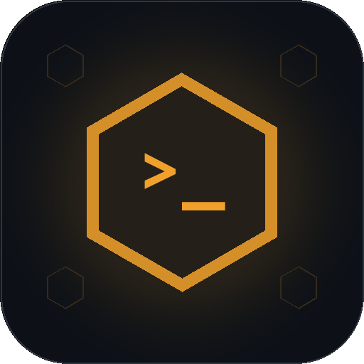
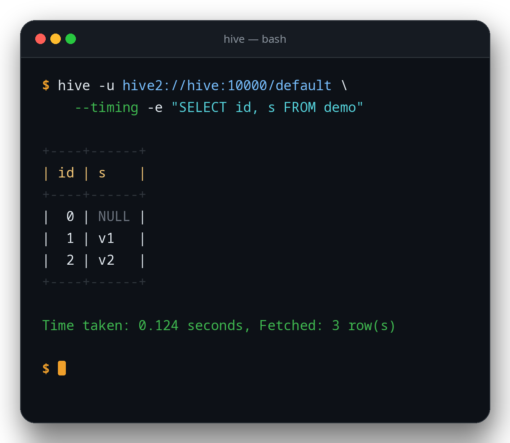

<p align="center">
  
</p>

<h1 align="center">hive-go</h1>

<p align="center">
  <strong>A pure-Go HiveServer2 client and CLI.</strong><br>
  Query Apache Hive from a single static binary — no JVM, no Hadoop client<br>
  libraries, no CGO, and no local Hive installation.
</p>

<p align="center">
  <a href="https://github.com/wgzhao/hive-go/actions/workflows/tests.yml"></a>
  <a href="https://github.com/wgzhao/hive-go/releases/latest"></a>
  <a href="LICENSE"></a>
  <a href="go.mod"></a>
  <a href="https://github.com/wgzhao/hive-go/releases"></a>
</p>

<p align="center">
  <a href="#install">Install</a> ·
  <a href="#quick-start">Quick start</a> ·
  <a href="#why-another-client">Why hive-go</a> ·
  <a href="#configuration">Configuration</a> ·
  <a href="#repl">REPL</a> ·
  <a href="CONTRIBUTING.md">Contributing</a>
</p>

<p align="center">
  
</p>

The project is called **hive-go**; the installed command is **`hive`**, mirroring
`hdfs-go`'s `hdfs` binary. It speaks the Thrift `TCLIService` protocol directly,
so the machine running it does not need a JVM, Hadoop client libraries,
`hive-jdbc`, or a Hive installation.

`hive` is intentionally narrower than Beeline: it connects, runs SQL, streams
result sets, supports a REPL and scripts, and prints results as tables,
vertical blocks, CSV, TSV, or JSON.

## Highlights

- **Zero runtime dependencies.** One statically linked binary; `CGO_ENABLED=0`
  builds work, including cross-compilation.
- **Speaks HiveServer2 natively.** Thrift `TCLIService` over binary protocol,
  SASL PLAIN (`NONE`/`LDAP`), `NOSASL`, and protocol V10 or V6.
- **Script-friendly by design.** Result data goes to stdout, diagnostics to
  stderr, with stable exit codes and six output formats.
- **A REPL you can live in.** History, `!` meta commands, multiple statements,
  and Ctrl-C query cancellation that keeps the session usable.
- **Fits an existing cluster.** Reads `hive-site.xml` and `HIVE_*` environment
  variables, with flags taking precedence.
- **Proven against real servers.** The E2E suite runs against Hive 3.1 and 4.0,
  covering columnar, row-based, and blob rowset results.

## Install

### With Go

Requires Go 1.22+:

```bash
go install github.com/wgzhao/hive-go/cmd/hive@latest
```

The binary lands in `$(go env GOPATH)/bin` (usually `~/go/bin`). Add that
directory to `PATH` if it is not there already.

### Prebuilt binaries

Tagged releases publish `hive-<tag>-<os>-<arch>.tar.gz` for Linux and macOS and
`.zip` for Windows, covering `amd64` and `arm64`. Download the archive for your
platform from [Releases](https://github.com/wgzhao/hive-go/releases), extract
it, and put `hive` on `PATH`.

### From source

```bash
make build          # produces ./hive
# or
CGO_ENABLED=0 go build -trimpath -o hive ./cmd/hive
```

Cross-compilation is supported:

```bash
make cross          # linux/darwin/windows, amd64+arm64
```

## Quick start

```bash
# NONE auth. Hive ignores the password but requires a non-empty one; the
# client supplies "x" automatically.
hive -u hive2://127.0.0.1:10000/default -n hive \
  -e "SELECT 1 AS x, 'hello' AS s"

# Interactive REPL
hive -u hive2://127.0.0.1:10000/default -n hive

# Script file
hive -u hive2://127.0.0.1:10000/default -n hive -f query.sql

# Non-TTY stdin
printf 'SELECT 1;\n' | hive -u hive2://127.0.0.1:10000/default

# JSON output for another tool
hive -u hive2://127.0.0.1:10000/default -n hive \
  --output-format json -e "SELECT * FROM default.demo LIMIT 10"
```

URL forms accepted:

```
hive2://[user[:password]@]host[:port][/database]
hive://[user[:password]@]host[:port][/database]
jdbc:hive2://host:10000/default;auth=NONE
```

`;auth=...` and `?auth=...` are recognized; other JDBC properties are ignored.

## Why another client?

| Tool | Form | Pure Go | CLI | Notes |
|---|---|---|---|---|
| **hive** (this project) | HiveServer2 TCLIService client + CLI | yes | yes | No JVM/Hadoop/CGO; focused Hive UX |
| Apache Beeline | Java CLI | no | yes | The reference client; requires JVM + jars |
| `usql` + `gohive/v2` | generic SQL CLI + Go driver | yes | yes | General psql-style tool; Hive is one driver among many |
| `beltran/gohive/v2` | Go `database/sql` driver | yes | no | Library; Kerberos variant uses CGO |
| DBeaver / DataGrip | JDBC GUI | no | GUI | Heavy, JVM-dependent |

The point of this project is a single static binary that behaves like a small
Beeline for the common case: connect to HiveServer2, run SQL, read results.

## Status

**v0.1.0 is the first public preview.** The client is functional and verified,
but the project is pre-1.0: CLI flags and the Go API may change, and it has not
been hardened for every production environment. See the
[changelog](CHANGELOG.md) for release contents.

Verified end-to-end against a real HiveServer2:

- Hive `3.1.0.3.1.4.0-315`, protocol V10, auth `NONE`
- `NONE`, `NOSASL`, and `LDAP` code paths (the E2E suite in this repository was
  run with `NONE`; the other two need a matching endpoint to be exercised)
- columnar results, row-based results, and Hive's blob rowset
  (`binaryColumns` + `TCompactProtocol`)
- 5000-row result sets at `--fetch-size 7`
- NULL bitmaps, Unicode, embedded newlines/tabs, DECIMAL/DATE/TIMESTAMP,
  ARRAY/MAP/STRUCT textual values, protocol V6 fallback, and query cancellation
- session properties and variables, init scripts, `--force`, custom delimiters,
  streaming tables, JSONL, binary formats, and the extended REPL commands

No unit tests are used. The verification mechanism is the E2E suite under
`cmd/hive/e2e/`, which talks to a real server and writes a repeatable
artifact directory.

## Authentication

| Mode | Flag | Behavior |
|---|---|---|
| `none` | `--auth none` (default) | SASL PLAIN; the server does not verify the password. The client sends `x` if none is given. |
| `nosasl` | `--auth nosasl` | No SASL handshake; plain Thrift binary transport. |
| `ldap` | `--auth ldap` | SASL PLAIN with the supplied username/password. |

**Security warning:** without TLS, LDAP credentials cross the network in
cleartext. Use LDAP only on a trusted network. TLS is not implemented in this
version.

Kerberos, HTTP transport, TLS, and custom SASL mechanisms are explicitly out of
scope for v1.

## Configuration

Precedence (highest first):

1. command-line flags
2. values in `--url`
3. environment variables
4. `hive-site.xml` (`HIVE_CONF_DIR`, then `$HIVE_HOME/conf`)
5. defaults (`localhost:10000`, `none`)

Environment variables:

```
HIVE_SERVER2_URL  HIVE_URL
HIVE_HOST  HIVE_PORT  HIVE_DATABASE  HIVE_USER  HIVE_PASSWORD
HIVE_AUTH  HIVE_PROTOCOL  HIVE_FETCH_SIZE
HIVE_CONF_DIR  HIVE_HOME
```

`hive-site.xml` is read for `hive.server2.thrift.port`,
`hive.server2.authentication`, `hive.server2.transport.mode`, and
`hive.server2.use.SSL`. HTTP transport or SSL being enabled is reported as an
unsupported configuration rather than silently ignored.

## Scripts and variables

```bash
hive ... -i init.sql -f report.sql          # init script, then the main script
hive ... --force -f cleanup.sql             # keep going after errors; exit 1
hive ... --delimiter ';;' -f statements.sql
hive ... --hivevar day=2026-11-07 \
        --hiveconf hive.exec.parallel=true \
        -e 'SELECT * FROM events WHERE dt = "${hivevar:day}"'
```

- `--hiveconf K=V` sets a Hive session configuration property. `--hivevar K=V`
  defines a client-side variable. Both options may be repeated.
- `${hivevar:name}`, `${hiveconf:name}`, `${env:NAME}` and `${system:name}` are
  substituted before a statement is sent. A bare `${name}` means a hivevar.
  Undefined variables are an error; write `\${...}` for a literal reference.
- `-i/--init-file` runs before the main script or REPL and may contain meta
  commands. `--force` continues after statement errors and exits 1 at the end.
  `--delimiter` accepts a multi-character terminator outside quotes and
  comments.
- `-w/--password-file` reads the password from a file (the file must not also
  be passed with `-p`). A warning is printed when the file is accessible by
  other users.
- Unsupported JDBC URL options such as `serviceDiscoveryMode=zooKeeper`,
  `ssl=true`, `transportMode=http` and `principal=...` are rejected with an
  explicit error. `;hiveconf:KEY=VALUE` and `;hivevar:NAME=VALUE` URL parameters
  are accepted.

## Output

```bash
hive ... --output-format table       # default, Beeline-like borders
hive ... --output-format vertical
hive ... --output-format csv
hive ... --output-format tsv
hive ... --output-format json
hive ... --output-format jsonl       # one JSON object per line
hive ... --no-header --null-string '<null>'
hive ... --null-empty --max-column-width 40
hive ... --stream                    # stream table rows instead of buffering
hive ... --binary-format hex         # text, base64 (default) or hex
```

- Result data goes to stdout; status, errors, info, and timing go to stderr.
- Table/vertical/TSV escape control characters visibly (`\n`, `\t`, `\r`, `\\`).
  Column widths use terminal display width, so CJK and emoji align correctly.
  Ambiguous-width characters count as one cell so layout is locale-independent.
- CSV follows RFC 4180 quoting and keeps embedded newlines inside quoted fields.
- JSON preserves NULL as `null`, booleans as booleans, integer/float values as
  numbers, and binary values as base64 by default. JSON and JSONL are written
  incrementally. HiveServer2 returns DECIMAL, DATE, TIMESTAMP, CHAR/VARCHAR,
  and complex values (ARRAY/MAP/STRUCT) as strings, so those remain JSON
  strings; this avoids precision loss and matches the server representation.
- Table and vertical output buffer the result for optimal column widths. With
  `--stream`, a table buffers the first 1000 rows and then writes rows as they
  arrive; if a later value is wider than the current column, a new table block
  is started with wider columns instead of truncating the value.
- `--max-column-width` truncates table/vertical cells to a display width and
  applies only to those formats; CSV, TSV, JSON and JSONL are never truncated.
- `--fetch-size` controls rows per `FetchResults` call (default 1000). The client
  keeps fetching until the server returns an empty batch; Hive 3 has been
  observed to return `hasMoreRows=false` while more rows exist, so
  `hasMoreRows` alone is not used as the termination condition.

## REPL

Prompt: `hive (database)> `; continuation lines use `      -> `.
History defaults to `~/.hive-go_history` (use `--no-history` to disable).

Meta commands:

```
!schemas              SHOW DATABASES
!tables [pattern]     SHOW TABLES [LIKE 'pattern']
!columns <table>      DESCRIBE <table> (alias: !describe)
!outputformat FMT     table, vertical, csv, tsv, json or jsonl
!delimiter STR        set the statement delimiter (default ;)
!run <file>           execute a script (alias: !source)
!history              show command history
!record [file|off]    record result output to a file
!dbinfo               show server, protocol and authentication details
!set                  show settings
!set outputformat csv
!set fetchsize 500
!set verbose on|off
!set timing on|off
!set header on|off
!set nullstring <s>
!set delimiter STR
!set binaryformat text|base64|hex
!fetchsize N
!verbose on|off
!timing on|off
!help
!quit
```

SQL statements end with `;` (or the delimiter set with `--delimiter`).
Multiple statements in one line/file work. The splitter understands
single/double quotes, backticks, `--` comments, `/* */` comments, backslash
escapes, and doubled quotes.

Ctrl-C cancels the running query through `CancelOperation` and returns to the
prompt. In batch mode it exits with status 130. The session remains usable after
cancellation.

## Exit codes

| Code | Meaning |
|---|---|
| 0 | success |
| 1 | SQL, connection, or I/O error |
| 2 | usage/configuration error |
| 130 | interrupted/canceled |

## E2E tests

The suite creates a uniquely named temporary database, runs medium-to-hard
cases against the real server, and drops the database at the end. It refuses to
run unless `HIVE_ALLOW_DDL=1` is set.

```bash
HIVE_HOST=127.0.0.1 \
HIVE_PORT=10000 \
HIVE_AUTH=none \
HIVE_USER=hive \
HIVE_ALLOW_DDL=1 \
make e2e
```

Replace `HIVE_HOST`/`HIVE_PORT` with your endpoint. In the verified
environment, the Hive user must be `hive` (or another user with write access to
the HDFS warehouse); the default OS user cannot create tables in the managed
warehouse. The test database is created with `LOCATION '/tmp/<db>'` so the test
user owns the data and `DROP DATABASE ... CASCADE` removes it.

`E2E_SLOW=1` adds the cancellation case. `UPDATE_GOLDEN=1` regenerates golden
files from the current server output.

The `Tests` GitHub workflow runs the same suite against the official
`apache/hive:4.0.1` image started on the runner (embedded Derby metastore,
`NONE` auth, local MR engine); its per-case artifacts are attached to the
workflow run. The verified private endpoint is not reachable from hosted
runners, so runs against other servers remain manual or belong on a
self-hosted runner.

Artifacts are written to `cmd/hive/e2e/artifacts/<UTC timestamp>_<pid>/`:

```
env.txt            host/port/auth/user/version, no password
commands.log       commands executed
cases/<name>/      cmd, stdout, stderr, exit, diff/failure
report.txt         PASS/FAIL summary
report.json        machine-readable summary
cleanup.stdout     cleanup result (including remaining_databases=0)
```

## Protocol notes

The implementation uses Apache Thrift `TCLIService` generated from Hive 4.0.0's
IDL and the Thrift Go runtime `v0.19.0`.

- `OpenSession` requests protocol V10; `--protocol v6` forces V6.
- NONE/LDAP perform a SASL PLAIN handshake (Thrift status byte + 4-byte
  big-endian length framing), then reuse the stock `TFramedTransport`.
- NOSASL uses `TBufferedTransport` with no SASL framing.
- Query execution is asynchronous; the client polls `GetOperationStatus` with
  backoff and cancels via `CancelOperation` when the context is canceled.
- Result batches are decoded in this order: blob `binaryColumns`
  (TCompactProtocol), columnar `columns`, then legacy `rows`.
- NULL bitmaps use `nulls[i/8] & (1 << (i%8)) != 0`.
- Hive returns TIMESTAMP, DATE, DECIMAL, CHAR/VARCHAR, INTERVAL, ARRAY, MAP, and
  STRUCT values as strings in practice; the client prints them as returned.

## Code generation

Generated files are committed, so a normal build does not need the Thrift
compiler. To regenerate:

```bash
sudo apt-get install thrift-compiler   # 0.19.0
make generate
```

The IDL is `internal/tcliservice/TCLIService.thrift` (Apache Hive 4.0.0).

## Limitations

- No Kerberos/GSSAPI, HTTP transport, TLS, or custom SASL mechanisms.
- Complex type metadata from HiveServer2 is a primitive `ARRAY`/`MAP`/`STRUCT`
  entry, so the CLI displays those names rather than `ARRAY<STRING>`.
- Table and vertical output buffer the full result set unless `--stream` is
  used; CSV, TSV, JSON and JSONL stream.
- No SQL parser, autocomplete, or syntax highlighting; statements are sent to
  the server as written.
- No Kerberos means this cannot connect to most Kerberized production clusters.

## Community and contributing

- **Questions and ideas:** use
  [GitHub Discussions](https://github.com/wgzhao/hive-go/discussions).
- **Bugs and feature requests:** open an issue; the templates ask for the
  version, server details, and a reproduction.
- **Security reports:** do not open a public issue. Follow
  [SECURITY.md](SECURITY.md).
- **Pull requests:** read [CONTRIBUTING.md](CONTRIBUTING.md) first. The project
  is verified by E2E tests against a real HiveServer2, not unit tests, and all
  participants are expected to follow the
  [Code of Conduct](CODE_OF_CONDUCT.md).

## License

MIT. See `LICENSE`. The TCLIService IDL is Apache-2.0; see `NOTICE`.
